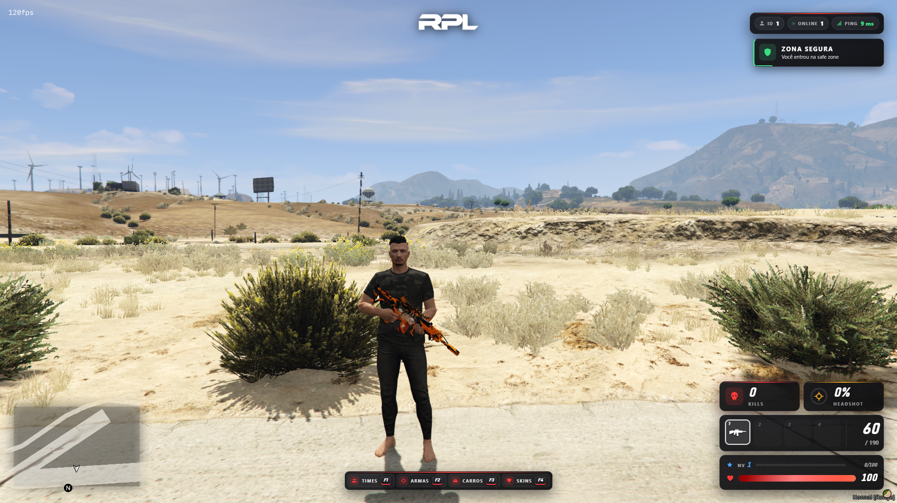

# PvP HUD - HUD para servidores de PvP no FiveM

HUD moderno feito para servidores de PvP, com vida, nível e XP, kills, porcentagem de headshot, slots de armas com munição e velocímetro. Interface em NUI (HTML, CSS e JavaScript) e lógica em Lua.

## Funcionalidades

- **Vida** com barra animada, "dano fantasma" e vinheta vermelha quando a vida está baixa
- **Nível e XP** com barra de progresso, aviso ao subir de nível e nível máximo configurável
- **Kills e % de headshot**, com contagem automática e efeito na tela ao matar (KILL / HEADSHOT)
- **4 slots de armas** (teclas 1 a 4) com ícone, munição do carregador e reserva
- **Velocímetro** em km/h ou mph, que aparece só dentro de veículos (com combustível opcional)
- **Informações do servidor**: ID, jogadores online e ping, com cor por qualidade da conexão
- **Atalhos** F1 a F4 no centro da tela (Times, Armas, Carros e Skins), configuráveis
- **Avisos na tela** (zona segura, perigo, alerta, nível e informação)
- Esconde os itens nativos do GTA que o HUD já mostra (estrelas, ícone de arma, dinheiro, barras do minimapa)
- Logo ou nome da cidade no topo (ou discreta no centro da tela)

## Tecnologias

- **Lua** (client e server)
- **FiveM / FXServer** (natives, eventos, exports, key mappings)
- **NUI**: HTML, CSS e JavaScript puro, com ícones em SVG

## Instalação

1. Copie a pasta para `resources/pvp_hud`.
2. Adicione no `server.cfg`:

   ```
   ensure pvp_hud
   ```

3. Coloque sua logo em `html/img/logo.png` (ou use `Config.Logo = nil` para mostrar só o nome).
4. Reinicie o servidor ou use `restart pvp_hud`.

## Estrutura

```
pvp_hud/
├── fxmanifest.lua
├── config.lua
├── client.lua
├── server.lua
└── html/
    ├── index.html
    ├── style.css
    ├── script.js
    ├── icons.js
    └── img/
        └── logo.png
```

## Configuração

Tudo fica no `config.lua`:

| Opção | Descrição |
| --- | --- |
| `Config.Name` / `Config.Logo` | Nome e logo da cidade no topo |
| `Config.ShowInfo` | ID, online e ping no canto superior direito |
| `Config.ShowStats` | Kills e % de headshot |
| `Config.SpeedUnit` | `'kmh'` ou `'mph'` |
| `Config.ShowFuel` | Mostra combustível (precisa de sistema de combustível) |
| `Config.AutoDetectKills` | Conta as kills sozinho |
| `Config.XPPerKill` / `Config.XPHeadshotBonus` | XP por kill e bônus de headshot |
| `Config.XPBase` / `Config.XPStep` | Curva de XP necessária por nível |
| `Config.MaxLevel` | Nível máximo |
| `Config.SlotKeys` | Teclas 1 a 4 pegam a arma do slot |
| `Config.Hotkeys` | Atalhos exibidos no centro da tela |
| `Config.HideNativeHud` | Esconde itens nativos do GTA |

O XP para subir do nível N para o N+1 é `XPBase + (N - 1) * XPStep`.

## Integração com outros scripts

### Exports

```lua
exports.pvp_hud:addXP(quantidade)        -- dá XP ao jogador
exports.pvp_hud:getLevel()               -- retorna nível e XP atuais
exports.pvp_hud:addKill(headshot)        -- registra uma kill (true/false para headshot)
exports.pvp_hud:notify(tipo, titulo, texto, duracao)
```

Tipos de aviso: `safe`, `danger`, `warn`, `level` e `info`.

### Eventos

```lua
TriggerEvent('pvp_hud:addXP', quantidade)
TriggerEvent('pvp_hud:kill', true)       -- true = headshot
TriggerEvent('pvp_hud:notify', 'safe', 'Zona segura', 'Texto', 5000)
```

### Resources opcionais

- **armas**: o HUD mostra os 4 slots escolhidos no menu de armas (F2)
- **pvp_creator**: mostra o ID fixo do personagem em vez do ID temporário do FiveM
- **pvp_skins**: o HUD se esconde durante a prévia da loja de skins

## Comandos

| Comando | O que faz |
| --- | --- |
| `/zerarxp` | Volta o jogador para o nível 1 com 0 de XP |
| `/zerarkills` | Zera kills e headshots |

## Salvamento

Kills, headshots, nível e XP são salvos no computador do jogador e continuam depois de reconectar (`Config.SaveStats`).

## Prints



## Autor

Feito por **Richard Pereira** - Discord: RPL
